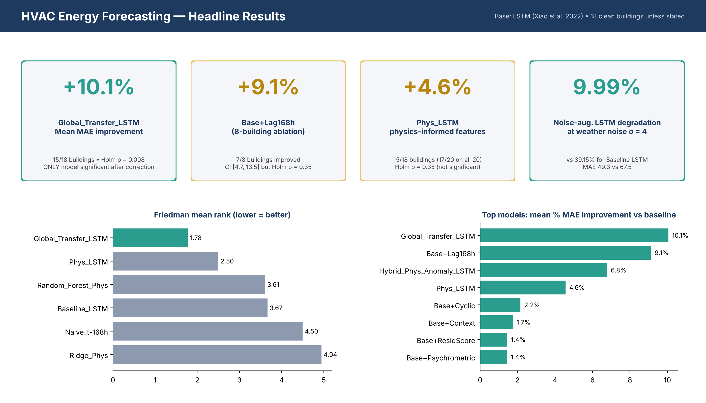

# HVAC Day-Ahead Energy Forecasting — Three Research Gaps beyond Xiao et al. (2022)

Complete notebook, results, figures and tables for a study that reproduces the LSTM HVAC energy-prediction baseline of Xiao et al. (2022, *Energy & Buildings*) on the **EnergyDetective2020** dataset and tests three research gaps:

1. **Gap 1 — Feature enrichment** (physics-informed, lag, psychrometric, context features)
2. **Gap 2 — Cross-building transfer learning** (pooling vs building-metadata-conditioned global model, zero-shot)
3. **Gap 3 — Deployment realism** (weather-forecast noise and split-conformal prediction intervals)

An appendix tests weather-aligned anomaly detection (IF / LOF) and input sanitisation (negative result).

## Main notebook

[`notebooks/HVAC_Forecasting_Research_Colab_Refined.ipynb`](notebooks/HVAC_Forecasting_Research_Colab_Refined.ipynb) — the full pipeline with all outputs saved (dataset loading, meter-quality diagnostics, feature construction, all models, statistics, Figures 1–15, tables).

> **Run profile:** the saved results use `RUN_PROFILE = "quick"` (1 seed = 42; extra experiments on an 8-building subset). Set `RUN_PROFILE = "final"` in the configuration cell for 3 seeds on all 20 buildings.

## Headline results (18 clean buildings, vs. base-paper LSTM)

| Finding | Result |
|---|---|
| Best model: `Global_Transfer_LSTM` | **+10.1%** mean MAE (42.39 vs 50.83), 15/18 buildings, Holm p = 0.008 (only result significant after correction) |
| Weekly lag (`Base+Lag168h`) | +9.1% MAE, 7/8 buildings (Holm p = 0.35, directional) |
| Physics features (`Phys_LSTM`) | +4.6% MAE, 15/18 buildings (Holm p = 0.35, directional) |
| Weather noise σ = 4 | Baseline degrades 39.2%; noise-augmented model only 10.0% |
| Conformal coverage at σ = 4 (90% nominal) | Static calibration 76–79%; noise-matched ≈ 89–90% |
| Anomaly filtering (IF/LOF), naive pooling | Worse than baseline |



Full write-up: [`docs/results_summary.md`](docs/results_summary.md)

## Repository layout

```
├── notebooks/   main Colab notebook (with outputs)
├── data/
│   ├── results/       metrics & summary tables (CSV, LaTeX)
│   └── predictions/   large per-model prediction files (Git LFS recommended)
├── results/
│   ├── figures/       Figures 1–15 (PNG)
│   ├── tables/        T01–T13: each results table as PNG
│   └── key_findings/  KF01–KF06: dashboard and finding cards
├── docs/results_summary.md
├── requirements.txt
└── LICENSE
```

## Reproduce

1. Download the **EnergyDetective2020** dataset (`EnergyDetective2020-main.zip`) — it is not included here. The notebook looks for `EnergyDetective2020-main/dataset` (with `ref_building/` and `weather/` folders) in `/content`, the working directory, or prompts for the zip upload in Colab.
2. Open the notebook in Google Colab (or locally after `pip install -r requirements.txt`) and run all cells. A GPU/TPU is optional; the quick profile runs on CPU.
3. The last cell packages all CSVs, predictions and figures into a zip.

## Large files / Git LFS

`data/predictions/` holds four CSVs (~84 MB total, largest 41.6 MB). GitHub warns above 50 MB and blocks above 100 MB per file; none exceed the limit. `.gitattributes` is preconfigured for Git LFS:

```bash
git lfs install
git add . && git commit -m "Initial commit" && git push
```

To avoid LFS, delete `.gitattributes`.

## Caveats

- Clean-subset results use 18 of 20 buildings; all-20 macro R² is negative because of outlier buildings — use MAE/median metrics there.
- Zero-shot (n = 3) and feature-ablation (n = 8) samples are small; Holm correction across ~22 comparisons is strict, so most gains are directional.
- Weather inputs are observed data with simulated noise, not real forecasts (see notebook Section 13).

## Citation

Xiao et al. (2022), "Impacts of data preprocessing and selection on energy consumption prediction model of HVAC systems based on deep learning", *Energy and Buildings* 258, 111832.

## License

MIT — see [LICENSE](LICENSE). Replace `<YOUR NAME>` in the license with your name before publishing.
